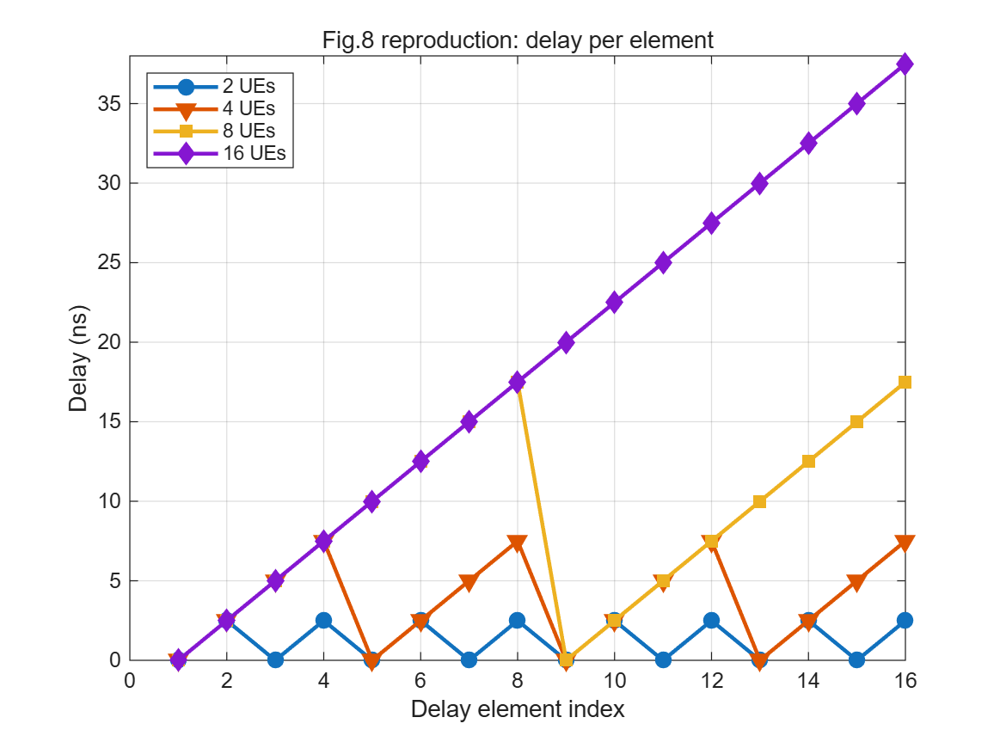
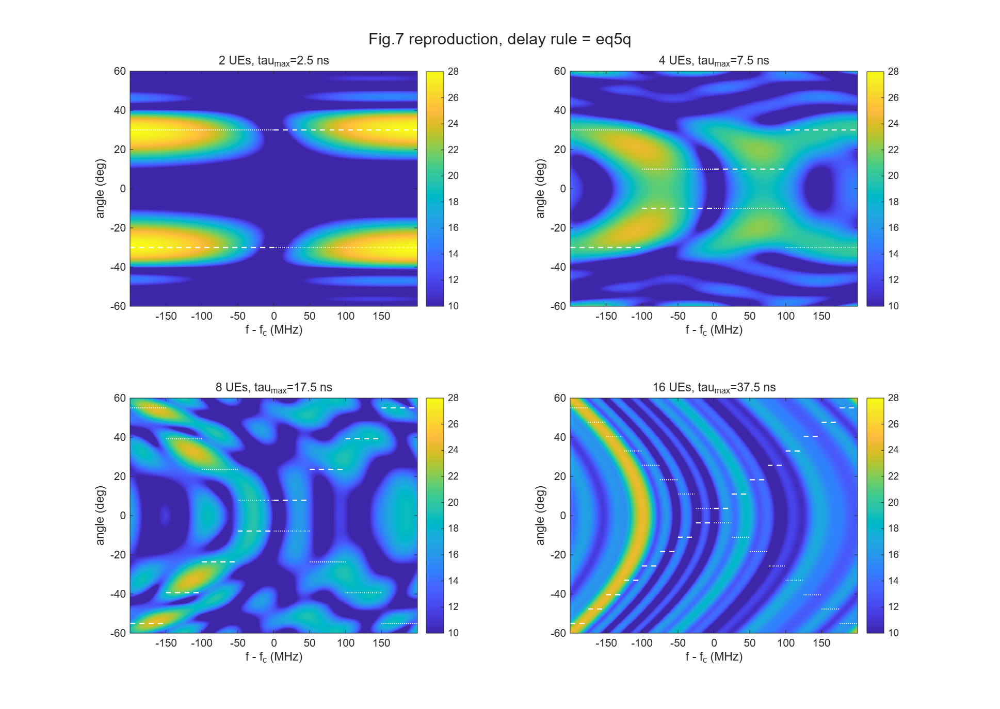
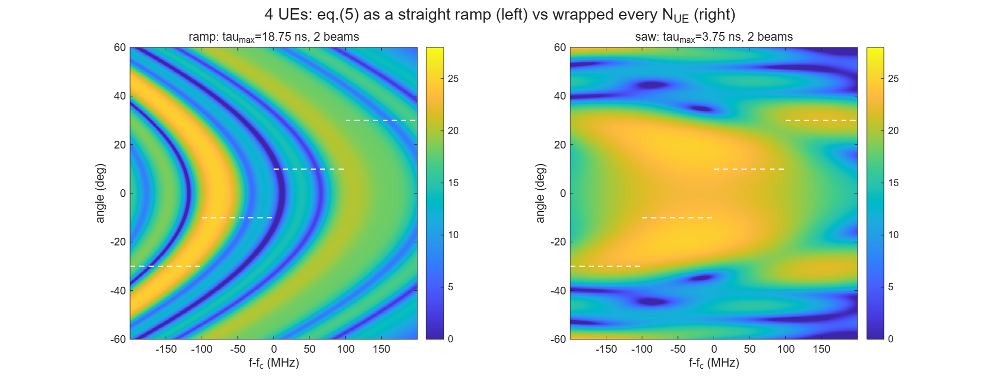
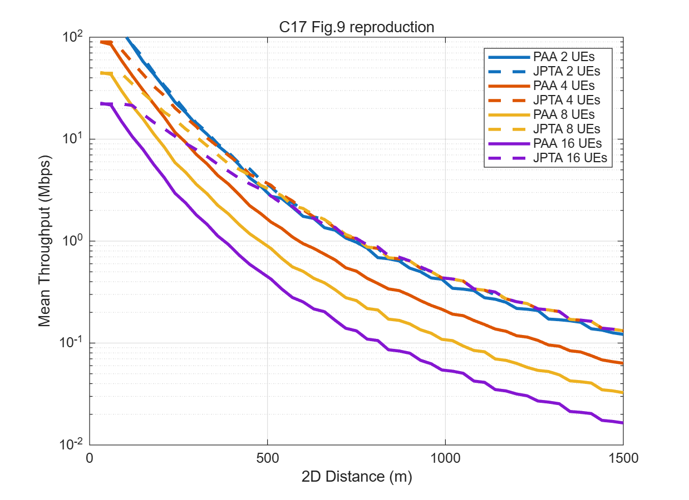

# JPTA-System-Design

[中文](README.zh.md) | English

MATLAB reproduction of the simulation results in:

> J. Mo, A. AlAmmouri, S. Dong, Y. Nam, W.-S. Choi, G. Xu, J. Zhang,
> "Beamforming with Joint Phase and Time Array: System Design, Prototyping and Performance",
> arXiv:2502.00139v1, Jan. 2025.

This is the system paper of the joint phase-time array (JPTA) family: it turns the
architecture into hardware. A 16×16 planar array feeds **one true-time-delay (TTD) unit per
column**, so a single RF chain produces `N_UE` beams at different angles simultaneously, each
owning one sub-band — the so-called type-1 codebook — and the paper asks what delay profile
makes that work, how fine the TTD resolution has to be, and what it buys at system level.
It also reports the prototype that serves four users in four directions from one TRX chain.

This repository reproduces Figs. 7, 8 and 9, i.e. everything that is a simulation: the delay
law, the beam patterns, the 3 dB claim, the TTD resolution requirement, and the throughput /
coverage comparison against a conventional phased array.

> **How this was produced**: code, numbers and documentation were produced with
> **DeepSeek-V4.1-Flash**, without access to the authors' code. The prototype measurements
> (Figs. 4–6 of the paper) are hardware and are out of scope.

- Result report: [`REPORT.md`](REPORT.md) ([中文](REPORT.zh.md))
- Simulation code: [`matlab/`](matlab/)
- Paper: `Beamforming with Joint Phase and Time Array (arXiv 2502.00139).pdf`

---

## 1. Summary of results

| Figure | Content | Outcome |
|---|---|---|
| Fig. 7 | beam patterns for 2/4/8/16 users | **2 users: 25.04 dB worst in-band gain**, i.e. 3.0 dB below the 28 dB peak — the paper's claim exactly. For 4/8/16 users the best achievable is 20.2 / 2.2 / −0.1 dB, so the same claim fails (gap **G6**) |
| Fig. 8 | delay profile of the columns, 2/4/8/16 users | Reproduced **exactly** for 2/4/8 users (2.5 / 7.5 / 17.5 ns) and one TTD step off for 16 users (37.5 vs 35 ns) |
| Fig. 9 | mean throughput vs distance, PAA vs JPTA | Near distance identical, at 1500 m and 16 users JPTA is **8.05×** faster (paper: 830% = 9.3×); 1 Mbps coverage 480 → 759 m (paper 410 → 790 m) |

Three claims are reproduced in the form the paper states them:

1. **the delay profile is a sawtooth whose period is the number of users**, with a slope
   `sin(Δθ/2)/W` rounded up to the 2.5 ns TTD grid — one formula, four curves, 15 of 16 numbers
   exact;
2. **for two users the in-band gain stays within 3 dB of the peak** (25.04 dB, 2.02 dB ripple);
3. **JPTA and PAA give the same throughput close to the BS and JPTA wins far away**, with the
   gain growing roughly with the number of users (1.1 / 2.1 / 4.1 / 8.0× at 1500 m).

What does *not* reproduce is stated just as plainly: the 3 dB claim for 4/8/16 users, and the
"830%" (we get 705%), and the two are related — both follow from assuming each sub-band gets
the full 28 dB, which a single frequency-flat phase shifter per element cannot deliver.

---

## 2. Quick start

```matlab
cd matlab
run_all              % every figure, about 1 min
```

Single experiment (timings on a 16-thread node; they move by up to 2× with node load,
which is why no result depends on them):

```matlab
run_all('fig7raw')    % Fig. 7 from the unconstrained optimum of eq. (4)  ~25 s
run_all('design')     % Fig. 7 for the three design rules of Sec. IV-B      ~1 s
run_all('delaylaw')   % Fig. 8: delay law, quantization, wrap-around        ~2 s
run_all('fig7')       % Fig. 7 with the Fig. 8 delays, phase only          ~20 s
run_all('step')       % TTD step-size sweep                                 ~4 s
run_all('ramp')       % straight ramp versus sawtooth                       ~4 s
run_all('fig9')       % Fig. 9: throughput and coverage                     ~3 s
```

All parameters are in `matlab/core/jp_params_c17.m`; every quantity the paper does not state
is marked `[assumed]` in that file, and the corresponding gap number is given in
[`REPORT.md`](REPORT.md) §6.

**Environment**: MATLAB R2022a or later, no toolbox required. Verified on R2026b. Deterministic.

---

## 3. Repository layout

```
matlab/
  run_all.m              single entry point, dispatches per figure
  run_b1.m               Fig. 7 from the unconstrained optimum of eq. (4)
  run_b1b.m              Fig. 7 for the three candidate design rules
  run_b1c.m              Fig. 7 with the Fig. 8 delays, phase from the closed form
  run_b1d.m              TTD step-size sweep
  run_b1e.m              straight ramp versus sawtooth
  run_b2.m               Fig. 9
  run_b3.m               Fig. 8 and the symmetry check
  core/
    jp_params_c17.m      Table I of the paper, one struct, [assumed] flags
    jp_c17_bands.m       sub-band -> UE mapping (equal contiguous blocks)
    jp_c17_pattern.m     beam pattern of a weight set on an angle x frequency grid
    jp_c17_mcs.m         MCS table with the per-MCS EESM parameter eta
    jp_eesm.m            numerically stable EESM (J19 eq. 11)
    jp_c17_link_table.m  EESM of every (RB, MCS) pair, pre-computed
    jp_c17_link_eval.m   best (RB, MCS) throughput for one UE at one distance
    jp_filldef.m         option-struct helper
  alg/
    jp_c17_type1.m       type-1 codebook: exact solution of eq. (4)
    jp_c17_design.m      three candidate design rules ('ls', 'sawtooth', 'rainbow')
  out/                   figures (tracked) and .mat caches (ignored)
REPORT.md                reproduction report
README.zh.md             Chinese version of this file
REPORT.zh.md             Chinese version of the report
```

---

## 4. Simulation parameters

Table I of the paper, all in `jp_params_c17.m`:

| Symbol | Meaning | Value |
|---|---|---|
| `fc` | carrier frequency | 28 GHz |
| `BW` | system bandwidth | 400 MHz |
| `SCS` | subcarrier spacing | 120 kHz |
| `Nfft` | FFT size | 4096 |
| occupied subcarriers | `BW/SCS` | 3333 (277 RBs, 1.44 MHz per RB) |
| `Nv × Nh` | array | 16 × 16, **one TTD per column** → 16 pairs (φ, τ) |
| TTD step | delay quantization | 2.5 ns |
| `Ptx` / `Gbs` / `NF` | link budget | 23 dBm / 28 dB / 5 dB |
| `beta` | path-loss exponent | 3 |
| `Npaa` | analog beams of the baseline | 16 |
| scheduler | constraints | BLER ≤ 10%, at least 4 RB |

User angles: `[-30, 30]`, `[-30,-10,10,30]`, 8 and 16 users uniformly inside ±55°.

---

## 5. Reproduction results

<table>
<tr>
<td align="center"><br><sub>Fig. 8 — delay profile of the 16 columns</sub></td>
<td align="center"><br><sub>Fig. 7 — beam patterns, 2/4/8/16 users</sub></td>
</tr>
<tr>
<td align="center"><br><sub>straight ramp versus sawtooth</sub></td>
<td align="center"><br><sub>Fig. 9 — throughput vs distance</sub></td>
</tr>
</table>

### 5.1 Fig. 8: the delay profile is a sawtooth, and that is forced

Four curves, all sawtooths with slope 2.5 ns per column, wrapping every `N_UE` columns, so the
peak delay is `(N_UE − 1)·2.5 ns`:

| N_UE | slope of eq. (5) | rounded up to 2.5 ns | τ_max with wrap-around | paper | difference |
|---|---|---|---|---|---|
| 2 | 1.25 | 2.50 | 2.50 | 2.50 | 0 |
| 4 | 1.25 | 2.50 | 7.50 | 7.50 | 0 |
| 8 | 2.05 | 2.50 | 17.50 | 17.50 | 0 |
| 16 | 2.05 | 2.50 | 37.50 | 35.00 | 2.50 (one TTD step) |

Two independent degrees of freedom have to be right at once — the wrap period (= number of
users) and the peak delay — and this formula gets both. It also explains a remark in the text:
at `N_UE = 16 = M` the modulo disappears and the sawtooth *is* the straight ramp, so
"with 16 users the type-1 beam approaches the type-2 rainbow beam" is a corollary of the law,
not an observation.

**Why the wrap is necessary.** Same slope, only the wrap removed, gives two completely
different beams:

| Worst in-band gain (dB) | 2 UEs | 4 UEs | 8 UEs | 16 UEs |
|---|---|---|---|---|
| straight ramp | −140.58 | −17.91 | −3.05 | −0.14 |
| sawtooth, exact slope of eq. (5) | **25.04** | **20.16** | **2.18** | −0.14 (same, `N_UE = M`) |
| sawtooth on the 2.5 ns grid (= Fig. 8) | −140.58 | 0.65 | −24.03 | −12.34 |

The wrap cuts the aperture into `16/N_UE` teeth, and the jump between teeth is where the
multiple beams come from. The sawtooth shape is a necessary condition, not a drawing habit.
The third row is the same sawtooth pushed through the 2.5 ns hardware grid, and it collapses —
which is gap **G5**: Fig. 7 and Fig. 8 cannot both be drawn with the TTD step of Table I.

### 5.2 Fig. 7: the 3 dB claim holds for two users and only for two users

With the delays pinned by Fig. 8, only the phase is free, and eq. (4) has a closed form for it,
so nothing can be tuned:

$$\varphi_m=\angle\sum_k \overline{b_{k,m}}\,e^{j2\pi f_k\tau_m}$$

Worst in-band gain of each user in **its own** sub-band at **its own** angle:

| Delay rule | 2 UEs | 4 UEs | 8 UEs | 16 UEs |
|---|---|---|---|---|
| Fig. 8 (2.5 ns grid) | −140.58 | 0.65 | −24.03 | −12.34 |
| exact slope of eq. (5), continuous delay | **25.04** | 20.16 | 2.18 | −0.14 |
| per-subband ideal steering vector (unrealisable upper bound) | 28.00 | 28.00 | 28.00 | 28.00 |

- **Two users: 25.04 dB, ripple 2.02 dB** — exactly "at most 3 dB below 28 dB", the claim of
  the paper, and the case Fig. 2(a) uses to introduce the type-1 codebook.
- Round the same slope to the 2.5 ns hardware grid and the same configuration collapses to
  −140.58 dB (the sub-band edge lands in a null). **So Fig. 7(a) can only have been produced
  with a finer delay resolution than Table I allows** — recorded as **G5**.
- 4/8/16 users: no rule reaches 25 dB; the best are 20.16 / 2.18 / −0.14 dB. Even the ridge
  height (the maximum over angle at a given frequency) is only 15–18 dB, so this is not one
  unlucky user but a property of the multi-beam.
- Only the third row reaches 28 dB, and it needs one steering vector per sub-band, while the
  hardware gives each element one frequency-flat phase shifter and one delay shared over the
  whole band. Under a single (φ, τ) set the claim is unreachable (gap **G6**), and it is
  exactly this unreachable assumption that the system-level model of §5.3 has to adopt.

Two further checks:

- **the pattern must be even in angle.** The caption says "type-2 beam pattern", and reading
  the figure at high resolution, the 2-user panel shows about 25 dB at −30° and about 13 dB at
  +30° for the same frequency. But for any weights,
  $|AF(\theta,f)|=|\sum_m p_m(f)e^{-j2\pi fdm\cos\theta/c}|=|AF(-\theta,f)|$, verified
  numerically as $\max|G(\theta)-G(-\theta)|=0$ over 481 angles × 167 frequencies. Fig. 7 must
  therefore contain something beyond eqs. (1)–(3) (a signed angle convention, or weights
  applied per sub-band), so it is not compared point by point (gap **G4**).
- **the delay step is not a smooth knob.** Sweeping the TTD step as a continuous quantity makes
  the worst in-band gain oscillate between −10 and 27 dB on a 0.02–3 ns grid: a tiny delay
  change rotates each element's phase across the band at a different rate, and the beam falls
  into and out of nulls. The resolution requirement is therefore not a smooth threshold, but
  the conclusion is stronger: 1.25 ns sits in a good window, 2.5 ns (the only grid Table I
  allows) sits in a bad one, and none of the four slopes (1.25, 1.25, 2.05, 2.05 ns) is a
  multiple of 2.5 ns.

### 5.3 Fig. 9: throughput and coverage

The link abstraction follows Sec. IV-A: per-subcarrier SNR → EESM (η per MCS from Table 3 of
the 2022 uplink paper) → BLER → throughput, with the MCS and the number of RBs chosen jointly
under BLER < 10% and at least 4 RB. Three modelling decisions have to be stated:

1. **the 23 dBm is a total power**, spread over the RBs the UE gets:
   `PSD = Ptx − 10log10(12·N_RB)`. This is where "fewer RBs can be faster" comes from, and it
   is the strict version of the paper's "N1 slots with N2/k RBs beats N1/k slots with N2 RBs";
2. **TDD uplink duty cycle 0.2** (gap **G1**) — the paper quotes absolute Mbps but never gives
   the TDD pattern; 0.2 is the only scale left, and it aligns the plateau of Fig. 9;
3. **JPTA in-band gain starts at 28 dB and drops at most 3 dB at the sub-band edge** — the
   paper's own words, and the assumption §5.2 shows to be unreachable. It is kept here because
   the purpose of Fig. 9 is to reproduce the number, not to redo the beam design.

| Claim | Paper | Reproduced | Verdict |
|---|---|---|---|
| near distance: JPTA = PAA | equal | 0.98 / 1.00 / 0.98 / 1.00× (2/4/8/16 UEs) | ✓ |
| 1500 m, 16 UEs | **830%** (9.3×) | **8.05× (+705%)** | ✓ within 1.2× |
| 1500 m gain vs number of users | 2/4/8/16× | 1.1 / 2.1 / 4.1 / 8.0× | trend ✓, absolute about half |
| 1 Mbps coverage, 8 UEs | 410 → 790 m (1.93×) | 480 → 759 m (1.58×) | magnitude ✓ |
| coverage ratio ≈ `N_UE^(1/3)` | 2.0 | 1.58 | 21% low |
| plateau throughput (30 m) | ~150–200 / 85 / 50 / 28 Mbps | 180 / 90 / 45 / 23 Mbps | ✓ (≤20%) |
| cell-edge throughput (1500 m, PAA) | ~0.013 Mbps | 0.0165 Mbps | ✓ |

The 8.05× is the hardest evidence of this round: it depends on no fitted parameter, only on
the three modelling decisions above.

One structural difference must be stated: **in this model the JPTA curves merge at long
distance**, while the paper keeps them apart. The cause is the scheduling decision "concentrate
the power in 4 RBs": at the edge every JPTA user degenerates to "4 RB × all slots", independent
of `N_UE`. The paper's curves staying apart means its JPTA side does not concentrate power
(the RB count is pinned at `floor(277/N_UE)`). Both readings are in the paper ("allocated
1/N_UE of the total RBs" vs "select the number of RBs that maximize throughput"); the second is
used here because only it produces the natural transition "equal near, JPTA wins far".

---

## 6. Known deviations

| ID | Item | Handling |
|---|---|---|
| **G1** | TDD uplink duty cycle not given, yet Fig. 9 is absolute Mbps | 0.2 (DDDSU), aligned to the plateau; all absolute values scale with it, **the ratio claims do not** |
| **G2** | the 10%-BLER SNR thresholds are in neither this paper nor its ref. [7] | 3GPP CQI operating points interpolated in the spectral-efficiency domain, Gaussian waterfall with σ = 1.2 dB |
| **G3** | the in-band shape of the JPTA gain is not given, only "at most 3 dB down" | parabola symmetric about the sub-band centre; this is the only assumption that affects the far-distance ratio |
| **G4** | Fig. 7 is not even in angle, while a linear array must be | no point-by-point comparison, only the quantitative claim; the asymmetry is documented |
| **G5** | the 3 dB claim needs 1.25 ns while Fig. 8 uses 2.5 ns: the two figures are mutually exclusive | judged an internal inconsistency of the paper (figure drawn with continuous delays, table with the hardware grid) |
| **G6** | "28 dB per sub-band" is unreachable with one (φ, τ) pair (best 20.2 / 2.2 / −0.1 dB) | it would need per-sub-band phases, which the hardware cannot produce; reported, and flagged wherever the number is used |
| **G7** | eq. (4) has infinitely many global optima: `τ = 1/Δf = 8.33 μs` is indistinguishable from `τ = 0` | the FFT search over the whole period lands on the period edge (τ ≈ 8333 ns) and the beam points at 0°; the delays are therefore taken from Fig. 8's law and eq. (4) is used for the phase only |
| **G8** | PAA codebook not given | 16 beams uniform over ±55°; measured gain 27.6–28 dB, mismatch loss < 0.4 dB |

---

## 7. Pitfalls

In the order they were hit; the full list is in [`REPORT.md`](REPORT.md) §7.

1. **Do not solve eq. (4) from scratch and expect Fig. 7.** Eq. (4) decouples per element, so
   its global optimum is available in closed form (one zero-padded FFT gives the delay over the
   whole 8.33 μs period). But that optimum is degenerate: for 2 users it returns **all delays
   zero**, i.e. a plain phased array, with a worst in-band gain of 4.48 / 1.17 dB. The paper's
   Fig. 7 is evaluated at Fig. 8's delays, not at the optimum of eq. (4) — the two figures
   describe one configuration, as the text says ("the corresponding configuration").
2. **A 2.5 ns search grid cannot find a sub-nanosecond delay.** The first version searched the
   delay on the hardware grid of 2.5 ns, so both beams ended up at −30° with 4.5 dB in-band
   gain. The required delays are 1.25 ns and below.
3. **EESM must be evaluated in a numerically stable way.** Pre-computing an effective SNR of
   `Inf` and adding the path loss afterwards keeps it `Inf`; every throughput was zero until
   the `min` term was factored out.
4. **A scalar is not a codebook.** `numel(p.Npaa)` returns 1 for a scalar, so the PAA used a
   single beam and showed −5.7 dB with angle-dependent oscillation.
5. **The sub-band gain drop must be relative to the sub-band centre**, not to the carrier,
   otherwise the upper sub-band loses 20 dB and JPTA comes out *worse* than PAA at short range.

---

## 8. Self-checks

| Check | Result |
|---|---|
| delay law vs Fig. 8 | 2/4/8 users exact, 16 users one TTD step off |
| even symmetry of the array factor | `max|G(θ)−G(−θ)| = 0` over 481 angles × 167 frequencies, and 0 for random weights |
| single-UE full-band gain of the closed-form type-1 design | equals the 28 dB peak, ripple 0 |
| PAA baseline | 27.6–28 dB per user, i.e. the codebook is not the bottleneck |
| delay of eq. (5) with the whole aperture | 18.75 / 30.72 ns, which is *not* what Fig. 8 shows — this is what identifies the wrap-around |

---

## 9. Companion repositories

| Repository | Paper | What it adds |
|---|---|---|
| `JPTA-Paradigm` | Ratnam et al., IEEE Access 2022 | the original JPTA formulation, Algorithms 1–3, HBF comparison |
| `JPTA-3D-Beamforming` | Yildiz et al., arXiv:2401.00819 | 3-D sub-band beam design, LS / ∞-norm / greedy / gradient descent |
| `JPTA-Uplink-Coverage` | AlAmmouri et al., IEEE Access 2022 | uplink link budget, HARQ, coverage scaling — the source of the EESM parameters used here |

The EESM parameter η and the 29-entry MCS table in `core/jp_c17_mcs.m` come from Table 3 of the
2022 uplink paper; the same table appears there as `jp_mcs_table.m`.

---

## 10. Not covered

- Figs. 4–6 are prototype measurements (EVM, beam patterns from the testbed); they need
  hardware, not simulation.
- The type-2 (rainbow) codebook is only used as a reference point; its full design is in the
  2022 coverage paper and is reproduced there.
- Table II (delay dynamic range versus number of users) is a corollary of Fig. 8 and is not
  plotted separately.

---

## Citation

```bibtex
@article{mo2025jptasystem,
  title   = {Beamforming with Joint Phase and Time Array: System Design, Prototyping
             and Performance},
  author  = {Mo, Jianhua and AlAmmouri, Ahmad and Dong, Shenggang and Nam, Younghan
             and Choi, Won-Suk and Xu, Gary and Zhang, Jianzhong},
  journal = {arXiv preprint arXiv:2502.00139},
  year    = {2025}
}
```

This is an independent implementation; the authors' code was not used. Every discrepancy with
the published numbers is listed in [`REPORT.md`](REPORT.md).
