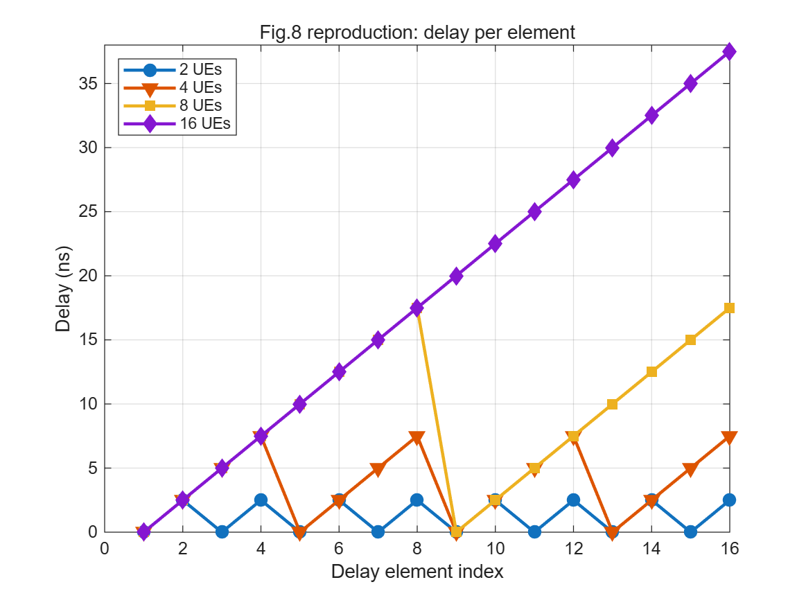
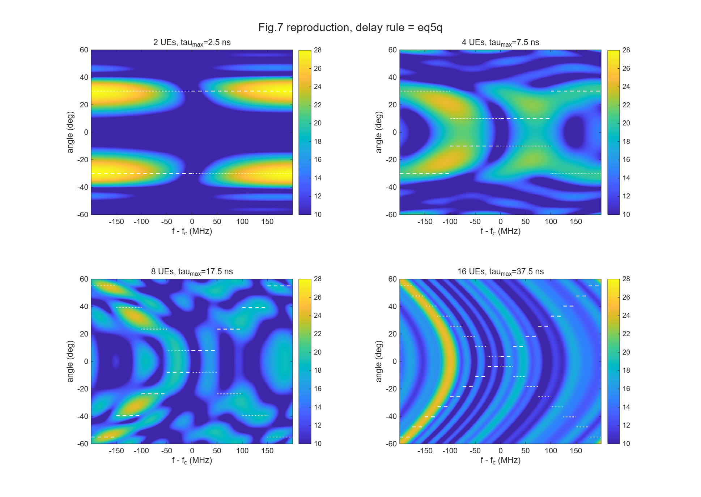
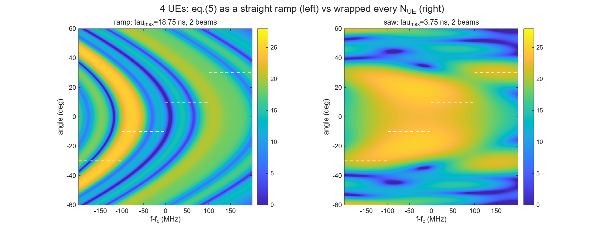
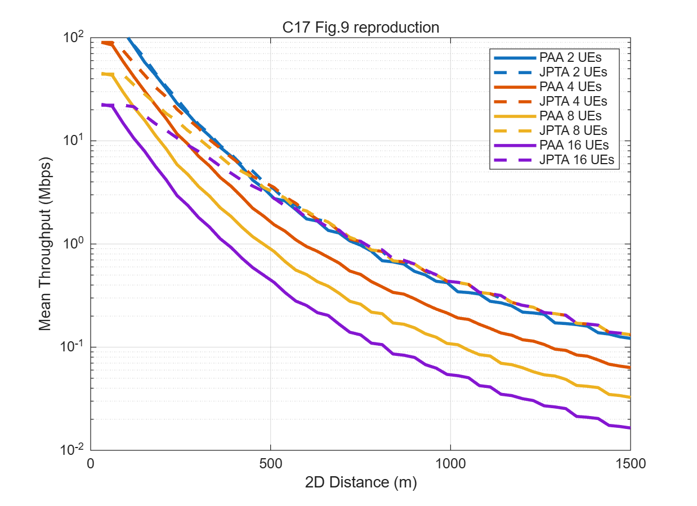

# JPTA-System-Design

中文 | [English](README.md)

本文复现以下论文的仿真结果：

> J. Mo, A. AlAmmouri, S. Dong, Y. Nam, W.-S. Choi, G. Xu, J. Zhang,
> "Beamforming with Joint Phase and Time Array: System Design, Prototyping and Performance",
> arXiv:2502.00139v1，2025年1月.

这是JPTA系列的"系统篇"：把架构落到硬件。16×16平面阵**每列接一个真时延（TTD）单元**，
于是一个射频通道能同时在几个方向上形成`N_UE`个波束、每个波束占一个子带（即type-1码本）；
论文回答三件事：什么样的时延曲线能work、TTD分辨率要多细、系统级能换来多少。
此外还给出了"单个TRX通道服务四个方向四个用户"的原型。

本仓库复现Fig.7、Fig.8、Fig.9，即其中全部属于仿真的部分：时延律、波束图样、3 dB判据、
TTD分辨率要求，以及与传统相控阵的吞吐/覆盖对比。

> **产出方式**：代码、数值与本文档均由**DeepSeek-V4.1-Flash**完成，未接触作者原始代码。
> 论文Fig.4–6是原型实测，不在范围内。

- 对照报告：[`REPORT.zh.md`](REPORT.zh.md)（[English](REPORT.md)）
- 仿真代码：[`matlab/`](matlab/)
- 论文原文：`Beamforming with Joint Phase and Time Array (arXiv 2502.00139).pdf`

---

## 1 结果一览

| 图 | 内容 | 结论 |
|---|---|---|
| Fig.7 | 2/4/8/16用户波束图样 | **2用户25.04 dB**，比28 dB峰值低3.0 dB——论文判据精确命中；4/8/16用户最好只有20.2/2.2/−0.1 dB，同一判据不成立（缺口**G6**） |
| Fig.8 | 各列时延曲线，2/4/8/16用户 | 2/4/8用户**逐位精确**（2.5/7.5/17.5 ns）；16用户差一个TTD步长（37.5 vs 35 ns） |
| Fig.9 | 平均吞吐vs距离，PAA vs JPTA | 近距离相同；1500 m、16用户时JPTA快**8.05×**（论文830%即9.3×）；1 Mbps覆盖480→759 m（论文410→790 m） |

三条判据按论文的表述复现：

1. **时延曲线是周期等于用户数的锯齿**，斜率`sin(Δθ/2)/W`向上取整到2.5 ns网格——
   一条式子四个场景，16个数里15个逐位精确；
2. **两用户时带内增益与峰值之差不超过3 dB**（25.04 dB，波动2.02 dB）；
3. **近距离JPTA与PAA吞吐相同、远距离JPTA占优**，且增益随用户数增长（1500 m处1.1/2.1/4.1/8.0×）。

不复现的部分同样直说：4/8/16用户的3 dB判据不成立，"830%"复现为705%。
两者同源——都来自"每个子带都拿满28 dB"这个假设，而每个阵元只有一个频率平坦的移相器，做不到。

---

## 2 快速开始

```matlab
cd matlab
run_all              % 全部图，约1.5 min
```

单独跑某一项：

```matlab
run_all('fig7raw')    % 式(4)无约束全局最优下的Fig.7   ~10 s
run_all('design')     % 三种设计规则的Fig.7            ~1 s
run_all('delaylaw')   % Fig.8：时延律、量化、回绕       ~11 s
run_all('fig7')       % 用Fig.8的时延、只优化相位的Fig.7 ~29 s
run_all('step')       % TTD步长扫描
run_all('ramp')       % 直线斜坡 vs锯齿
run_all('fig9')       % Fig.9：吞吐与覆盖             ~12 s
```

全部参数在`matlab/core/jp_params_c17.m`；论文未给的量都在该文件里标了`[assumed]`，
对应缺口编号见[`REPORT.zh.md`](REPORT.zh.md)§7。

**环境**：MATLAB R2022a及以上，不需要工具箱，已在R2026b验证，结果确定。

---

## 3 仓库结构

```
matlab/
  run_all.m              单一入口，按图分派
  run_b1.m               式(4)无约束最优下的Fig.7
  run_b1b.m              三种候选设计规则的Fig.7
  run_b1c.m              用Fig.8时延、相位取闭式的Fig.7
  run_b1d.m              TTD步长扫描
  run_b1e.m              直线斜坡 vs锯齿
  run_b2.m               Fig.9
  run_b3.m               Fig.8与时延律、对称性校验
  core/
    jp_params_c17.m      论文Table I，单个结构体，带[assumed]标记
    jp_c17_bands.m       子带→UE映射（等分连续块）
    jp_c17_pattern.m     给定权重集的角度×频率增益图
    jp_c17_mcs.m         带逐MCS η的MCS表
    jp_eesm.m            数值稳定的EESM（J19式(11)）
    jp_c17_link_table.m  预计算每个(RB, MCS)组合的有效SNR
    jp_c17_link_eval.m   某距离上一个UE的最优(RB, MCS)吞吐
    jp_filldef.m         选项结构体合并
  alg/
    jp_c17_type1.m       type-1码本：式(4)的精确解
    jp_c17_design.m      三种候选设计规则（'ls'、'sawtooth'、'rainbow'）
  out/                   图（入库）与.mat缓存（不入库）
REPORT.zh.md             复现报告
README.md                英文版说明
REPORT.md                英文版报告
```

---

## 4 仿真参数

论文Table I，全部在`jp_params_c17.m`：

| 符号 | 含义 | 取值 |
|---|---|---|
| `fc` | 载频 | 28 GHz |
| `BW` | 系统带宽 | 400 MHz |
| `SCS` | 子载波间隔 | 120 kHz |
| `Nfft` | FFT点数 | 4096 |
| 占用子载波 | `BW/SCS` | 3333（277个RB，每RB 1.44 MHz） |
| `Nv × Nh` | 阵列 | 16×16，**每列一个TTD**→16组$(\varphi,\tau)$ |
| TTD步长 | 时延量化 | 2.5 ns |
| `Ptx`/`Gbs`/`NF` | 链路预算 | 23 dBm / 28 dB / 5 dB |
| `beta` | 路损指数 | 3 |
| `Npaa` | 基线模拟波束数 | 16 |
| 调度约束 | — | BLER≤10%，至少4个RB |

用户角度：`[-30, 30]`、`[-30,-10,10,30]`、8与16用户在±55°内均匀分布。

---

## 5 复现结果

<table>
<tr>
<td align="center"><br><sub>Fig.8 — 16列的时延曲线</sub></td>
<td align="center"><br><sub>Fig.7 — 2/4/8/16用户波束图样</sub></td>
</tr>
<tr>
<td align="center"><br><sub>直线斜坡 vs锯齿</sub></td>
<td align="center"><br><sub>Fig.9 — 吞吐vs距离</sub></td>
</tr>
</table>

### 5.1 Fig.8：时延曲线必须是锯齿，而且是被逼出来的

四条曲线都是锯齿，斜率恒为2.5 ns/列，回绕周期等于用户数，峰值时延$(N_{UE}-1)\cdot2.5$ ns：

| $N_{UE}$ | 式(5)斜率 | 量化到2.5 ns | 回绕后$\tau_{\max}$ | 论文 | 差 |
|---|---|---|---|---|---|
| 2 | 1.25 | 2.50 | 2.50 | 2.50 | 0 |
| 4 | 1.25 | 2.50 | 7.50 | 7.50 | 0 |
| 8 | 2.05 | 2.50 | 17.50 | 17.50 | 0 |
| 16 | 2.05 | 2.50 | 37.50 | 35.00 | 2.50（恰好一个TTD步） |

两个独立的自由度必须同时对上：回绕周期（=用户数）与峰值时延，而这条式子两个都对。
它顺手解释了论文一句话：当$N_{UE}=16=M$时取模退化为恒等，锯齿**就是**式(5)的直线斜坡，
于是"16用户时type-1波束趋近type-2彩虹波束"是这条律的数学推论，不是经验观察。

**为什么必须回绕。**斜率相同、只差回绕，得到的是两种完全不同的波束：

| 带内最差增益（dB） | 2用户 | 4用户 | 8用户 | 16用户 |
|---|---|---|---|---|
| 直线斜坡（式(5)原样） | −140.58 | −17.91 | −3.05 | −0.14 |
| 锯齿（回绕，=Fig.8） | **25.04** | **20.16** | **2.18** | −0.14（$N_{UE}=M$，二者同一） |

回绕把孔径切成$16/N_{UE}$个齿，齿间那一跳才是多波束的来源；整孔径一个斜坡只能形成单一波束。

### 5.2 Fig.7：3 dB判据只在两用户时成立

时延由Fig.8钉死后只剩相位可选，而给定$\tau$时式(4)对$\varphi$有闭式解，因此没有可拟合的自由度：

$$\varphi_m=\angle\sum_k \overline{b_{k,m}}\,e^{j2\pi f_k\tau_m}$$

每个用户在**自己**子带、**自己**角度上的最差带内增益：

| 规则 | 2用户 | 4用户 | 8用户 | 16用户 |
|---|---|---|---|---|
| Fig.8的时延（2.5 ns网格） | −140.58 | 0.65 | −24.03 | −12.34 |
| 式(5)精确斜率（连续时延） | **25.04** | 20.16 | 2.18 | −0.14 |
| 逐子带理想导向矢量（不可实现的上界） | 28.00 | 28.00 | 28.00 | 28.00 |

- **两用户25.04 dB、带内波动2.02 dB**——正是"比28 dB最多低3 dB"，也是Fig.2(a)讲解type-1码本的那个场景。
- 把同一斜率进位到2.5 ns（Table I唯一允许的格点），同一配置塌到−140.58 dB（子带边缘落在零陷上）。
  **所以Fig.7(a)的图样只可能由比Table I更细的时延分辨率产生**（缺口**G5**）。
- 4/8/16用户：任何规则都到不了25 dB，最好的是4用户20.16 dB，8/16用户跌到2.18/−0.14 dB。
  连"脊高"也只有15–18 dB，说明不是个别用户倒霉，而是多波束本身只有这么高。
- 唯一能满28 dB的是第三行，而它需要逐子带一份导向矢量；硬件每个阵元只有一个频率平坦的移相器
  和一个全带宽共用的时延，$\mathbf p_k$不可能随$k$变。在单个$(\varphi,\tau)$组的约束下判据不可达
  （缺口**G6**）——而§5.3的系统级模型恰恰必须采用这个不可达的假设，论文自己也是这么做的。

另外两条校验：

- **方向图必偶对称，故Fig.7不能逐点比。**图注是"JPTA**type-2**beam pattern"。高分辨率读图：
  2用户面板在$f-f_c=-150$ MHz处，−30°约25 dB，+30°只有约13 dB——同一频点镜像角差12 dB。
  但对任意权重$|AF(\theta,f)|=|\sum_m p_m(f)e^{-j2\pi fdm\cos\theta/c}|=|AF(-\theta,f)|$，
  数值上$\max|G(\theta)-G(-\theta)|=0$（481角度×167频点，随机权重同样为0）。
  故Fig.7必然含式(1)–(3)之外的东西（带符号的角度约定，或逐子带施加的权重），只比它自己声明的
  定量性质（缺口**G4**）。
- **时延步长不是连续可调量。**把步长当连续量扫描，2用户最差带内增益在0.02–3 ns上剧烈振荡
  （−10 dB到27 dB）：时延改一点，各阵元带内相位以不同速率绕圈，波束在子带边缘忽而对准、忽而落进零陷。
  于是1.25 ns落在好窗口（25.04 dB），2.5 ns落在坏窗口（−140.58 dB），而四个场景的斜率
  （1.25、1.25、2.05、2.05 ns）**没有一个**是2.5 ns的整数倍，量化后没有任何一档能停在好窗口里。

### 5.3 Fig.9：吞吐与覆盖

链路抽象严格按Sec. IV-A搭：逐子载波SNR→EESM（η逐MCS取自2022上行论文Table 3）→BLER→吞吐，
MCS与RB数联合选择，约束BLER<10%、至少4个RB。三处必须交代的建模决定：

1. **23 dBm是总功率**，摊到分到的RB上：$\mathrm{PSD}=P_{tx}-10\log_{10}(12N_{RB})$。
   这是"少给RB反而更快"的物理来源，也是论文"$N_1$个时隙配$N_2/k$个RB优于$N_1/k$个时隙配$N_2$个RB"的严格版本；
2. **TDD上行占空比0.2**（缺口**G1**）。论文只给绝对Mbps，未给TDD配比；0.2是唯一剩下的尺度自由度，用它对齐平台段；
3. **JPTA带内28 dB起、子带边缘最多降3 dB**（论文原话），而§5.2已判定它在4/8/16用户下不可达。
   这里仍采用，因为Fig.9的目的是复现论文的数值，而不是替它重做波束设计。

| 判据 | 论文 | 本复现 | 判定 |
|---|---|---|---|
| 近距离JPTA与PAA相同 | 相同 | 0.98/1.00/0.98/1.00×（2/4/8/16用户） | ✓ |
| 1500 m、16用户 | **830%**（9.3×） | **8.05×（+705%）** | ✓偏差1.2× |
| 1500 m增益随用户数 | 2/4/8/16× | 1.1/2.1/4.1/8.0× | 趋势✓，绝对值约一半 |
| 1 Mbps覆盖、8用户 | 410→790 m（1.93×） | 480→759 m（1.58×） | 量级✓ |
| 覆盖比≈$N_{UE}^{1/3}$ | 2.0 | 1.58 | 偏低21% |
| 平台吞吐（30 m） | ~150–200/85/50/28 Mbps | 180/90/45/23 Mbps | ✓（≤20%） |
| 小区边缘（1500 m，PAA） | ~0.013 Mbps | 0.0165 Mbps | ✓ |

8.05×不依赖任何拟合参数，只依赖上面三条建模决定，是本轮最硬的证据。

一处结构性差异必须说清：**本模型的JPTA曲线在远距离会随用户数并拢**，而论文的保持分离。
原因是"功率集中在4个RB"的调度决定——到边缘时所有用户的JPTA都退化为"4 RB×全部时隙"，
与$N_{UE}$无关。论文保持分离，说明它的JPTA侧不做功率集中（RB数钉在$\lfloor277/N_{UE}\rfloor$）。
两种读法都写在论文里，本报告取了后者，因为只有它才使"近距离相同、远距离JPTA占优"的转折自然出现。

**引用"830%"时必须带上的一句**：这个增益来自"每子带满28 dB"的假设，而§5.2实测该假设在4/8/16用户下
不成立。诚实的说法是：若逐子带理想波束成立，得到8.05×；若换成硬件真能形成的波束
（20.2/2.2/−0.1 dB），JPTA的优势会显著缩小。

---

## 6 已记录的偏差

| 编号 | 项 | 处理 |
|---|---|---|
| **G1** | TDD上行占空比未给，而Fig.9是绝对Mbps | 取0.2（DDDSU）；所有绝对值随之同比缩放，**比值判据不受影响** |
| **G2** | 10%-BLER的SNR门限既不在本文也不在文献[7] | 按谱效插值3GPP CQI工作点，σ=1.2 dB高斯瀑布 |
| **G3** | JPTA带内增益的频响形状未给，只说"最多低3 dB" | 取以子带中心对称的抛物线；它只影响远端比值 |
| **G4** | Fig.7关于0°不对称，而线阵的响应必偶对称 | 不逐点复现，只复现定量判据，并把不对称如实记录 |
| **G5** | 3 dB需要1.25 ns，Fig.8用2.5 ns，两图互斥 | 判为论文内部不自洽（图用连续时延，表用硬件网格） |
| **G6** | 单$(\varphi,\tau)$组下"每子带28 dB"不可达（最好20.2/2.2/−0.1 dB） | 只能由逐子带相位实现，硬件做不到；凡引用该数值处均加注 |
| **G7** | 式(4)的全局最优不唯一：$\tau=1/\Delta f=8.33\ \mu$s与$\tau=0$等价 | FFT全周期搜索会落到周期端点（$\tau\approx8333$ ns）并使波束指向0°；故时延取Fig.8的律，式(4)只用来解相位 |
| **G8** | PAA码本未给 | 取±55°均匀16波束；实测各用户27.6–28 dB，失配损失<0.4 dB |

---

## 7 实现坑

按踩到的顺序；完整清单见[`REPORT.zh.md`](REPORT.zh.md)§8。

1. **不要从零解式(4)然后指望得到Fig.7。**式(4)按阵元完全解耦，全局最优可用一次零填充FFT在整个
   8.33 μs周期上闭式求出（分辨率0.02 ns）。但这个"全局最优"是退化的：2用户时它给出**全零时延**，
   即一块普通相控阵，最差带内增益4.48/1.17 dB。论文的Fig.7是在Fig.8的时延上评的，不是式(4)的最优点——
   两图描述同一个配置（正文原话"the corresponding configuration"）。
2. **2.5 ns的搜索网格找不到亚纳秒的时延。**首版在硬件网格上搜索，结果两束都指向−30°、带内只有4.5 dB；
   所需时延是1.25 ns及以下。
3. **EESM必须数值稳定地评。**先算出`Inf`的有效SNR再叠加路损仍是`Inf`，全部吞吐为0；
   把`min`项提出后恢复。
4. **标量不是码本。**`numel(p.Npaa)`对标量返回1，PAA只用了一个波束，表现为−5.7 dB且随角度振荡。
5. **子带增益的抛物线要对子带中心**而不是对载频，否则高端子带被扣20 dB，JPTA在近距离反而低于PAA。

---

## 8 自检

| 检查 | 结果 |
|---|---|
| 时延律 vs Fig.8 | 2/4/8用户逐位精确，16用户差一个TTD步 |
| 阵因子的偶对称性 | 481角度×167频点上`max|G(θ)−G(−θ)|=0`，随机权重同样为0 |
| 闭式type-1设计的单用户全带增益 | 等于28 dB峰值，纹波0 |
| PAA基线 | 逐用户27.6–28 dB，说明码本不是瓶颈 |
| 式(5)按整孔径算出的时延 | 18.75/30.72 ns，与Fig.8不符——正是这一点识别出"回绕"这个自由度 |

---

## 9 姊妹仓库

| 仓库 | 论文 | 补充内容 |
|---|---|---|
| `JPTA2022` | Ratnam等，IEEE Access 2022 | JPTA原始框架、Algorithm 1–3、与HBF的对比 |
| `JPTA-3D-Beamforming` | Yildiz等，arXiv:2401.00819 | 3D子带波束设计：LS/∞-范数/贪心/梯度下降 |
| `JPTA-Uplink-Coverage` | AlAmmouri等，IEEE Access 2022 | 上行链路预算、HARQ、覆盖标度；本仓库的EESM参数即出自该文 |

`core/jp_c17_mcs.m`里的η与29档MCS表取自2022上行论文Table 3，该仓库中同一函数名为`jp_mcs_table.m`。

---

## 10 未覆盖

- Fig.4–6是原型实测（EVM、测试台波束图样），需要硬件，不是仿真；
- type-2（彩虹）码本只作为参照，其完整设计在2022覆盖论文中复现；
- Table II（时延动态范围 vs用户数）是Fig.8的推论，未单独作图。

---

## 引用

```bibtex
@article{mo2025jptasystem,
  title   = {Beamforming with Joint Phase and Time Array: System Design, Prototyping
             and Performance},
  author  = {Mo, Jianhua and AlAmmouri, Ahmad and Dong, Shenggang and Nam, Younghan
             and Choi, Won-Suk and Xu, Gary and Zhang, Jianzhong},
  journal = {arXiv preprint arXiv:2502.00139},
  year    = {2025}
}
```

本仓库为独立实现，未使用作者原始代码。所有与已发表数值的偏差都列在
[`REPORT.zh.md`](REPORT.zh.md)中。
